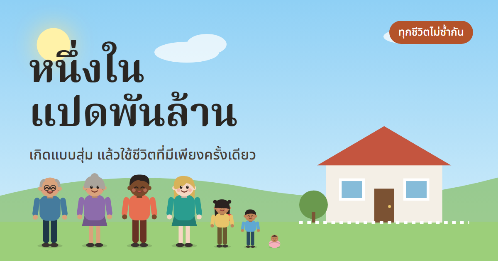

# หนึ่งในแปดพันล้าน 🌏

**เกิดแบบสุ่ม แล้วใช้ชีวิตที่มีเพียงครั้งเดียว**

เกมจำลองชีวิตบนเว็บ (ภาษาไทย) ทุกครั้งที่กด "เกิดเลย" คุณจะเกิดเป็นคนใหม่ ตามสถิติจริงของโลก: ประเทศ เพศ ครอบครัว จำนวนพี่น้อง และฐานะ แล้วใช้ชีวิตไปทีละปีจนวันสุดท้าย

## จุดเด่น

- **ทุกชีวิตไม่ซ้ำกัน:** มีชีวิตที่เป็นไปได้ 11,600 แบบ (58 ประเทศ × เพศ × ฐานะ 5 ระดับ × ครอบครัว 4 แบบ × พี่น้อง 5 แบบ) ชีวิตที่สุ่มได้แล้วจะไม่ถูกสุ่มซ้ำอีก
- **ข้อความไม่ซ้ำเดิม:** เหตุการณ์ คำถาม และคำถามสะท้อนตัวเองมีหลายแบบ เกมจะเลือกแบบที่คุณยังไม่เคยเห็น และเหตุการณ์ที่เจอใน 3 ชีวิตล่าสุดจะออกยากขึ้น
- **เหตุการณ์ไม่ซ้ำในชีวิตเดียว:** มีเหตุการณ์และการตัดสินใจกว่า 75 แบบ แต่ละแบบเกิดได้ครั้งเดียวต่อชีวิต
- **ครอบครัวตัวการ์ตูน:** พ่อ แม่ ปู่ย่าตายาย พี่น้อง คนรัก ลูก และหลาน ทุกคนมีชื่อตามภูมิภาค เติบโต แก่ตัว และจากไปตามตารางชีพจริงของประเทศ
- บ้านเปลี่ยนตามฐานะ (กระท่อม → บ้านหลังใหญ่) และท้องฟ้าเปลี่ยนตามช่วงวัย (เช้า → เย็น)
- อายุขัยคำนวณจากอายุคาดเฉลี่ยจริงของประเทศและเพศ ปรับตามสุขภาพและฐานะ
- รายได้คำนวณจาก GDP และค่า Gini แสดงเป็นบาทตามกำลังซื้อในไทย
- **ระบบเงินเต็มรูปแบบ:** รายรับ-รายจ่ายทุกปี (ค่าครองชีพ ค่าเลี้ยงลูก ค่ารักษา ผ่อนบ้าน ดอกเบี้ยหนี้) ทรัพย์สินสุทธิพร้อมกราฟ และหน้า "ใช้เงิน · ลงทุน" ให้เลือกที่เก็บเงิน (เงินฝาก พันธบัตร กองทุน หุ้น) ระดับการใช้จ่าย การกิน ประกันสุขภาพ ค่าซอง และสิ่งที่ทำได้ปีละครั้ง
- **การตัดสินใจที่มีราคา:** เรียนต่อ ย้ายเข้าเมือง ซื้อบ้าน ผ่อนรถ ให้ญาติยืมเงิน แชร์ลูกโซ่ รักษาโรค ดูแลพ่อแม่ ค่าเทอมลูก เกษียณ ฯลฯ ราคาแสดงบนปุ่มเป็นบาท
- เวลาหยุดที่อายุ 5, 15, 30, 50, 70 ถามว่าชีวิตของคนคนนี้ต่างจากชีวิตจริงของคุณอย่างไร (เลือกคำตอบหรือเขียนเอง) คำตอบส่งผลต่อสถานะและถูกเก็บในบันทึกชีวิต
- คนที่เกิดในวินาทีเดียวกันอีก 4 คนจากทั่วโลก
- โหมดอัตโนมัติ, ปุ่มตัดฉากที่หนักออก, ธีมสว่าง/มืด, แชร์ชีวิตให้เพื่อน

## เล่นบนเครื่องตัวเอง

ไม่ต้องติดตั้งอะไร เปิดไฟล์ `index.html` ในเบราว์เซอร์ได้เลย ข้อมูลการเล่นเก็บในเบราว์เซอร์ของผู้เล่นเท่านั้น

## โครงสร้างไฟล์

| ไฟล์ | หน้าที่ |
|---|---|
| `data.js` | ข้อมูลประเทศ ครอบครัว อาชีพ คำถามสะท้อนตัวเอง |
| `events.js` | เหตุการณ์และทางเลือกในชีวิต (เพิ่มได้ ใช้ `id` ที่ไม่ซ้ำ) |
| `variants.js` | ข้อความหลายแบบของเหตุการณ์ คำถาม ช่วงเวลาสำคัญ และเหตุการณ์เพิ่มเติม |
| `money.js` | ระบบเงิน: รายรับรายจ่ายรายปี การลงทุน ประกัน หน้าใช้เงิน · ลงทุน |
| `family.js` | สมาชิกครอบครัว ชื่อ และการวาดตัวการ์ตูน/บ้าน (SVG) |
| `game.js` | ระบบสุ่มไม่ซ้ำ โมเดลอายุขัย/รายได้ และหน้าจอ |

## ข้อมูล

ตัวเลขประเทศเป็นค่าประมาณปัดเศษ อิงจาก UN World Population Prospects, World Bank และ WHO เพื่อการเรียนรู้ ไม่ใช่ตัวเลขทางการ

แรงบันดาลใจจาก [1 in 8 Billion](https://1in8b.life/th/)

หากรู้สึกไม่สบายใจ โทรสายด่วนสุขภาพจิต **1323** ได้ตลอด 24 ชั่วโมง
